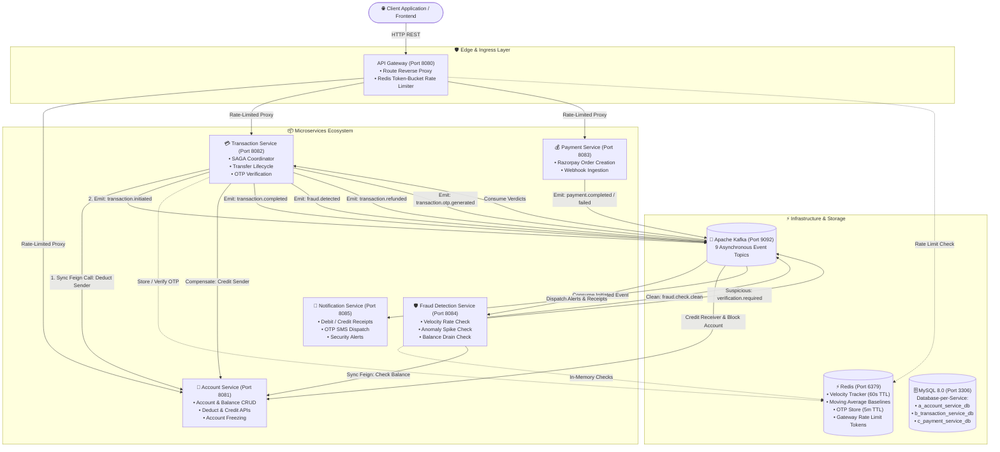
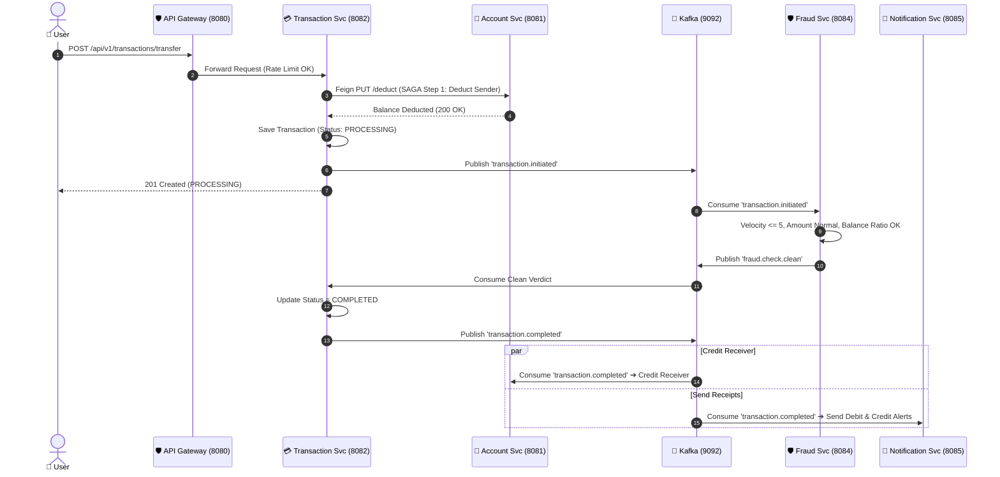
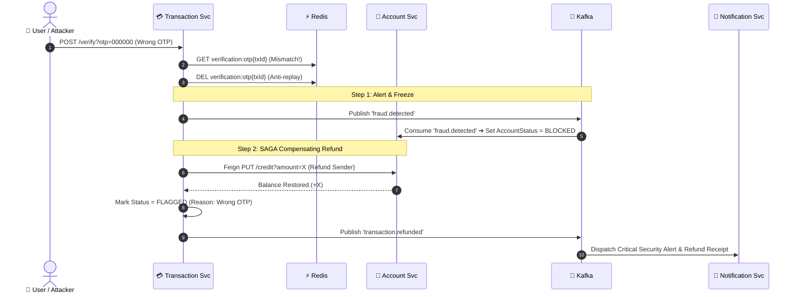

# 🏦 Distributed Banking & Real-Time Fraud Detection System

[](https://www.oracle.com/java/)
[](https://spring.io/projects/spring-boot)
[](https://spring.io/projects/spring-cloud-gateway)
[](https://kafka.apache.org/)
[](https://redis.io/)
[](https://www.mysql.com/)
[](https://www.docker.com/)
[](LICENSE)

An enterprise-grade, event-driven distributed banking ecosystem engineered with **Spring Boot 3**, **Spring Cloud Gateway**, **Apache Kafka**, **Redis**, and **MySQL**. 

The system enables secure peer-to-peer fund transfers, payment gateway top-ups via **Razorpay**, and sub-millisecond **real-time fraud detection** using in-memory sliding window counters and baseline moving averages. Data consistency across decoupled microservice databases is guaranteed using the **SAGA Pattern** with automated compensating refunds.

---

## 📑 Table of Contents
- [System Architecture](#-system-architecture)
- [Key Features](#-key-features)
- [Microservices Ecosystem](#-microservices-ecosystem)
- [Core End-to-End Flows](#-core-end-to-end-flows)
  - [1. Happy Path Transfer](#1-happy-path-fund-transfer)
  - [2. Fraud Detection & OTP Challenge](#2-fraud-detection--two-factor-otp-challenge)
  - [3. SAGA Compensating Refund & Account Freeze](#3-saga-compensating-refund--account-freeze)
- [Kafka Event Backbone & Redis Matrix](#-kafka-event-backbone--redis-matrix)
- [Tech Stack](#-tech-stack)
- [Getting Started](#-getting-started)
- [API Documentation](#-api-documentation)
- [Interview & Architecture Notes](#-interview--architecture-notes)

---

## 🏛️ System Architecture



---

## ✨ Key Features

- **🛡️ Distributed Rate Limiting:** Enforces client IP-based token-bucket limits via Spring Cloud Gateway and Redis Lua scripts to eliminate brute-force and DoS attacks.
- **⚡ Sub-Millisecond Fraud Engine:** Analyzes live transaction events in under 2ms using Redis in-memory data structures:
  1. **Velocity Check:** Tracks transactions in a 60-second sliding window (`INCR` + `EXPIRE 60s`).
  2. **Spending Spike Baseline:** Computes exponential moving averages (`newAvg = (prev + curr)/2`) and flags amounts $> 5\times$ historical baseline.
  3. **Balance Drain Protection:** Validates that transactions do not deplete $> 90\%$ of available liquid funds.
- **🔄 SAGA Pattern & Eventual Consistency:** Eliminates slow, blocking two-phase commits (2PC). Uses synchronous reservation on sender funds and asynchronous settlement with automatic compensating transactions on failure.
- **🔐 Two-Factor OTP Challenge:** Suspicious transactions are paused in a `PENDING_VERIFICATION` state. A 6-digit OTP is generated and cached in Redis with a 5-minute automated TTL.
- **💳 Payment Gateway Integration:** Complete Razorpay SDK integration for online deposits, checkout modals, and webhook verification (`payment.captured` / `payment.failed`).
- **🗃️ Database-per-Service Pattern:** Strict domain isolation across dedicated MySQL schemas (`a_account_service_db`, `b_transaction_service_db`, `c_payment_service_db`).
- **🔔 Asynchronous Omnichannel Notifications:** Notification hub consuming 6 distinct Kafka topics to trigger simulated SMS, email, and security warnings.

---

## 📦 Microservices Ecosystem

| Service | Port | Database | Primary Role & Interfaces |
| :--- | :---: | :---: | :--- |
| **`api-gateway`** | `8080` | Stateless | Spring Cloud Gateway, Redis token-bucket rate limiter, route forwarding. |
| **`account-service`** | `8081` | `a_account_service_db` | Customer accounts, balance operations, account status (`ACTIVE`, `BLOCKED`). |
| **`transaction-service`** | `8082` | `b_transaction_service_db` | SAGA orchestrator, transfer state machine, OTP generation, SAGA rollback. |
| **`payment-service`** | `8083` | `c_payment_service_db` | Razorpay order generation, checkout handling, webhook callbacks. |
| **`fraud-detection-service`** | `8084` | Redis In-Memory | 3-tier fraud engine, sliding window counters, moving average tracking. |
| **`notification-service`** | `8085` | Stateless | Event consumer, sends receipts, OTP tokens, refund alerts, and fraud warnings. |

---

## 🔄 Core End-to-End Flows

### 1. Happy Path Fund Transfer


---

### 2. Fraud Detection & Two-Factor OTP Challenge
If the Fraud Detection Service detects an anomaly (e.g. $> 5$ transfers within 60 seconds or amount $> 5\times$ historical average):
1. **Fraud Flag:** Emits `verification.required` to Kafka.
2. **OTP Generation:** Transaction Service switches status to `PENDING_VERIFICATION`, creates a 6-digit OTP, and stores it in Redis (`verification:otp{txId}`) with a **5-minute TTL**.
3. **Dispatch:** Emits `transaction.otp.generated` ➔ Notification Service sends OTP alert to user phone/email.
4. **Verification:** User calls `POST /api/v1/transactions/{id}/verify?otp=...`.
5. **Success:** If OTP matches, Redis deletes the key (preventing replay attacks), marks transaction `COMPLETED`, and emits `transaction.completed` to credit the receiver.

---

### 3. SAGA Compensating Refund & Account Freeze
If an unauthorized attacker enters the **wrong OTP** or the OTP **times out (5 minutes expire)**:


---

## 📨 Kafka Event Backbone & Redis Matrix

### Kafka Topics Registry (Port 9092)

| Topic Name | Producer Service | Consumer Service(s) | Key | Purpose |
| :--- | :--- | :--- | :--- | :--- |
| `transaction.initiated` | `transaction-service` | `fraud-detection-service` | `txId` | Triggers 3-rule fraud analysis |
| `fraud.check.clean` | `fraud-detection-service` | `transaction-service` | `txId` | Authorizes completion of clean transfer |
| `verification.required` | `fraud-detection-service` | `transaction-service` | `txId` | Requests OTP two-factor challenge |
| `transaction.otp.generated` | `transaction-service` | `notification-service` | `txId` | Dispatches OTP SMS/Email to user |
| `transaction.completed` | `transaction-service` | `account-service`, `notification-service` | `txId` | Credits receiver & dispatches receipts |
| `fraud.detected` | `transaction-service` | `account-service`, `notification-service` | `senderAcc` | Freezes compromised account (`BLOCKED`) |
| `transaction.refunded` | `transaction-service` | `notification-service` | `txId` | Alerts customer of refunded balance |
| `payment.completed` | `payment-service` | `notification-service` | `paymentId` | Razorpay payment capture confirmation |
| `payment.failed` | `payment-service` | `notification-service` | `paymentId` | Razorpay payment failure alert |

### Redis In-Memory Engines (Port 6379)

| Key Pattern | Data Structure | TTL | Purpose |
| :--- | :--- | :---: | :--- |
| `request_rate_limiter.{ip}` | Lua Token Bucket | N/A | API Gateway rate limiting (10 req/s, burst 20). |
| `fraud:velocity:{accountNumber}` | String Integer | `60s` | Incremented on transfer. Flags if count $> 5$ in 60s. |
| `fraud.avg_amount:{accountNumber}` | String Decimal | Permanent | Baseline spending average. Flags transfers $> 5\times$ average. |
| `verification:otp{transactionId}` | String (6 digits) | `5m` | Transient OTP token. Automatically evicted after 5 minutes. |

---

## 🛠️ Tech Stack

- **Language & Runtime:** Java 17, JVM
- **Frameworks:** Spring Boot 3.x, Spring Cloud Gateway, Spring Data JPA, OpenFeign, Spring Kafka, Spring Data Redis
- **Message Broker:** Apache Kafka 7.4.0, Zookeeper
- **Caching & State:** Redis 7.x
- **Databases:** MySQL 8.0 (InnoDB)
- **External Payment Gateway:** Razorpay Java SDK
- **Containerization:** Docker & Docker Compose
- **Build Tool:** Apache Maven

---

## 🚀 Getting Started

### 1. Prerequisites
- [Java 17 JDK](https://www.oracle.com/java/technologies/javase/jdk17-archive-downloads.html)
- [Apache Maven 3.8+](https://maven.apache.org/)
- [Docker Desktop](https://www.docker.com/products/docker-desktop/)

### 2. Clone the Repository
```bash
git clone https://github.com/<your-username>/Banking-system.git
cd Banking-system
```

### 3. Start Infrastructure via Docker Compose
Start Kafka, Zookeeper, Redis, and MySQL with a single command:
```bash
docker-compose up -d
```
Verify all containers are healthy:
```bash
docker ps
```

### 4. Build and Run the Microservices
Open separate terminal windows and run each microservice using Maven:

```bash
# 1. Start Account Service (Port 8081)
cd account-service/account-service
./mvnw spring-boot:run

# 2. Start Transaction Service (Port 8082)
cd transaction-service/transaction-service
./mvnw spring-boot:run

# 3. Start Fraud Detection Service (Port 8084)
cd fraud-detection-service/fraud-detection-service
./mvnw spring-boot:run

# 4. Start Notification Service (Port 8085)
cd notification-service/notification-service
./mvnw spring-boot:run

# 5. Start Payment Service (Port 8083)
cd payment-service/payment-service
./mvnw spring-boot:run

# 6. Start API Gateway (Port 8080)
cd api-gateway/api-gateway
./mvnw spring-boot:run
```

---

## 📡 API Documentation & Sample Requests

All requests should be routed through the **API Gateway** (`http://localhost:8080`).

### 1. Create a New Bank Account
```bash
curl -X POST http://localhost:8080/api/v1/accounts/create \
  -H "Content-Type: application/json" \
  -d '{
    "accountHolderName": "Alex Morgan",
    "email": "alex.morgan@example.com",
    "phone": "+1234567890",
    "accountType": "SAVINGS",
    "initialDeposit": 50000.00
  }'
```

### 2. Check Account Balance
```bash
curl -X GET http://localhost:8080/api/v1/accounts/{accountNumber}/balance
```

### 3. Initiate Peer-to-Peer Transfer (SAGA Flow)
```bash
curl -X POST http://localhost:8080/api/v1/transactions/transfer \
  -H "Content-Type: application/json" \
  -d '{
    "senderAccountNumber": "000184920491",
    "receiverAccountNumber": "000839201948",
    "amount": 2500.00,
    "description": "Invoice payment"
  }'
```

### 4. Verify OTP (For Flagged Transactions)
```bash
curl -X POST "http://localhost:8080/api/v1/transactions/{transactionId}/verify?otp=481920"
```

### 5. Create Razorpay Payment Order
```bash
curl -X POST http://localhost:8080/api/v1/payments/create-order \
  -H "Content-Type: application/json" \
  -d '{
    "accountNumber": "000184920491",
    "amount": 1000.00,
    "description": "Wallet top-up"
  }'
```

---

## 📚 Interview & Architecture Notes

Detailed system design documentation, interview cheat sheets, PowerPoint presentations, and vector diagrams are available in the **[`interview-notes/`](interview-notes/)** directory:

- 📊 **[PowerPoint Slide Deck (`.pptx`)](interview-notes/Banking_System_Architecture_and_Flows.pptx)**: 8 professionally designed 16:9 widescreen presentation slides.
- 🖼️ **[Figma Vector System Diagram (`.svg`)](interview-notes/diagrams/system_architecture_diagram.svg)**: Drag-and-drop vector diagram for Figma.
- 🔄 **[Figma Vector Sequence Flow (`.svg`)](interview-notes/diagrams/complete_transaction_flow.svg)**: End-to-end transaction sequence.
- 🌐 **[Interactive Web Visualizer (`.html`)](interview-notes/diagrams/interactive_architecture_viewer.html)**: Interactive browser-based architecture tool.
- 📝 **[Services Architecture Deep Dive](interview-notes/01_SERVICES_ARCHITECTURE.md)**
- 📝 **[End-to-End Flows with Detailed Diagrams](interview-notes/02_END_TO_END_FLOWS_WITH_DIAGRAMS.md)**
- 📝 **[Kafka & Redis Deep Dive](interview-notes/03_KAFKA_AND_REDIS_DEEP_DIVE.md)**
- 📝 **[SAGA Pattern & Consistency Guide](interview-notes/04_SAGA_TRANSACTIONS_AND_RESILIENCY.md)**
- 📝 **[Top 25+ Interview Q&A & Cheat Sheet](interview-notes/05_INTERVIEW_QUESTIONS_AND_ANSWERS.md)**

---

## 📄 License
This project is licensed under the [MIT License](LICENSE).
