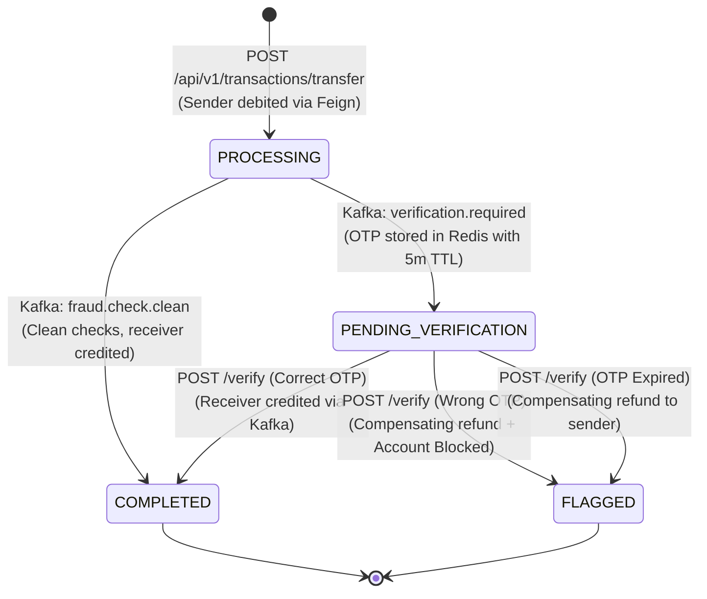
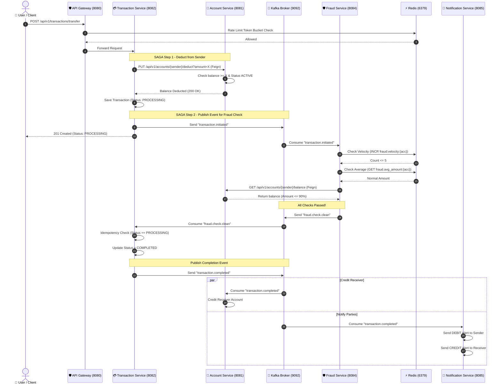
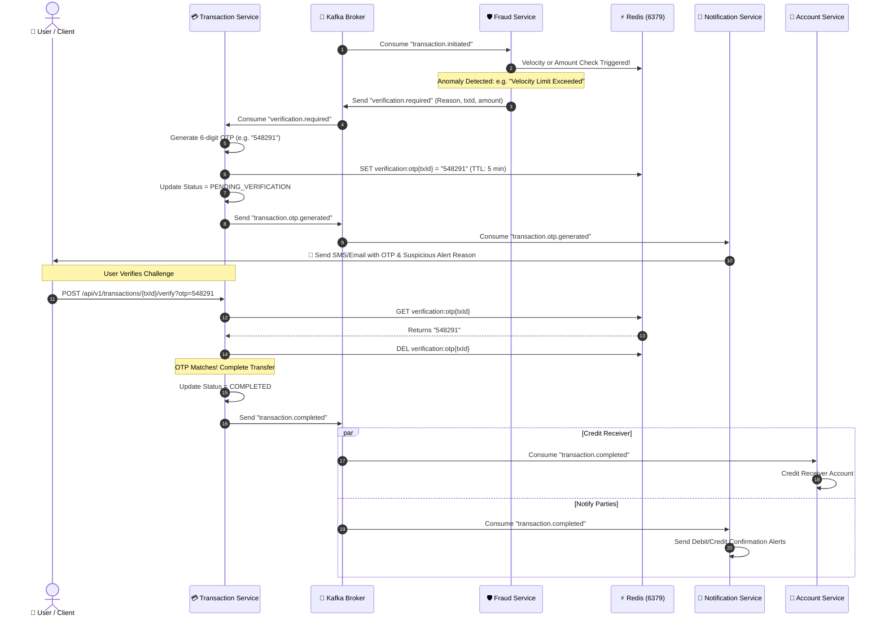
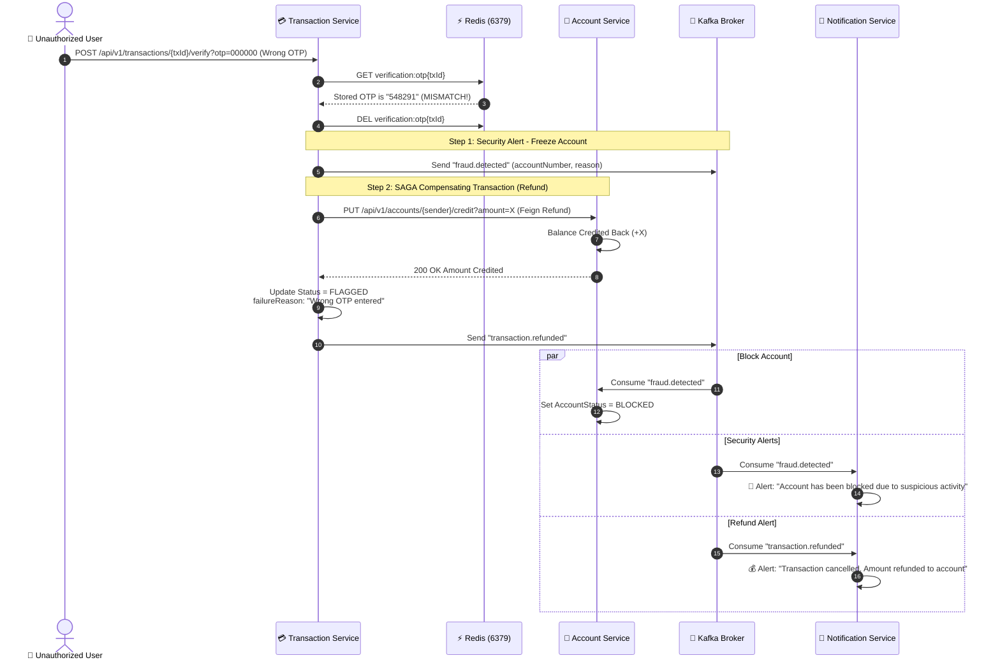
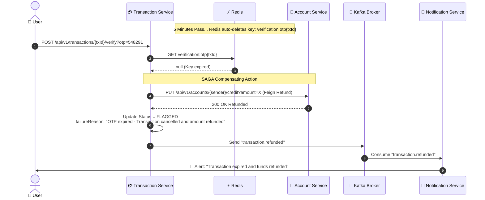
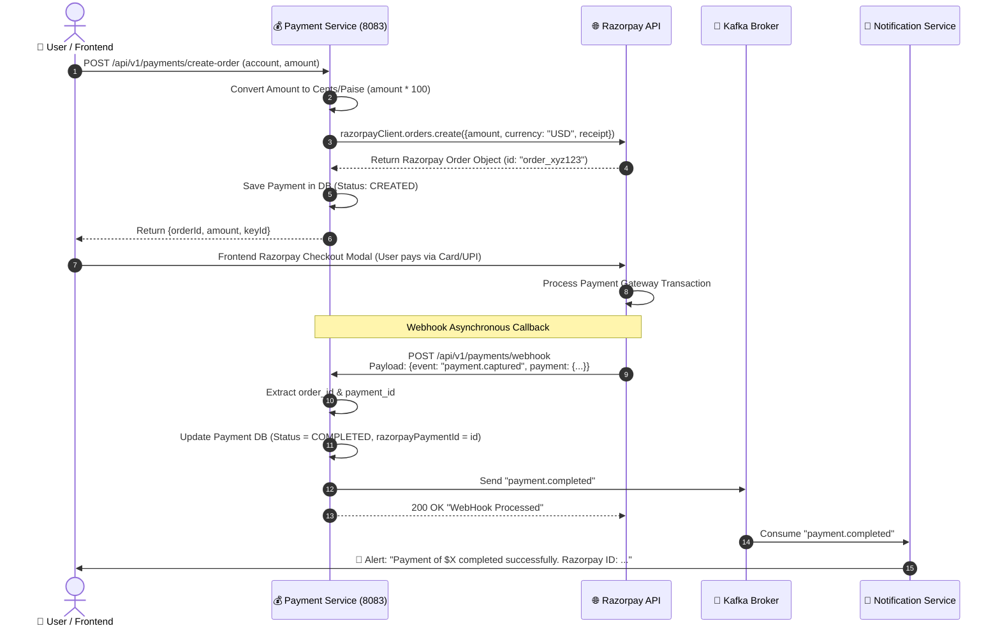

# 02. End-to-End Flows & Architecture Diagrams

This document contains detailed step-by-step walkthroughs and visual sequence diagrams for every core execution path in the Banking Fraud Detection system.

---

## 🧭 Master State Machine: Transaction Lifecycle

The `TransactionStatus` entity transitions through clearly defined states to maintain consistency:

---

## 🟢 Flow 1: Happy Path Fund Transfer (Clean Transaction)

This flow executes when the transaction does not trigger any of the 3 fraud detection rules.

### Sequence Diagram:

### Step-by-Step Breakdown:
1. **Client Request:** User posts transfer request (`senderAccountNumber`, `receiverAccountNumber`, `amount`, `description`).
2. **Gateway Check:** Gateway checks Redis token bucket. If quota is available, it routes to `transaction-service`.
3. **Fund Reservation (SAGA Step 1):** `TransactionService` uses OpenFeign to invoke `AccountService.deductBalance()`.
4. **State Persistence:** Transaction is saved in MySQL with status `PROCESSING`.
5. **Event Emission (SAGA Step 2):** Publishes `TransactionInitiatedEvent` to Kafka topic `transaction.initiated`.
6. **Fraud Analysis:** `FraudDetectionService` executes:
   - Velocity counter in Redis (must be $\le 5$ in 60s).
   - Moving average check in Redis (must be $\le 5\times$ historical avg).
   - Balance check via Feign (amount must be $\le 90\%$ of balance).
7. **Clean Result:** Emits `fraud.check.clean` to Kafka.
8. **Completion:** `TransactionService` marks status as `COMPLETED` and emits `transaction.completed`.
9. **Final Settlement & Alerting:** `AccountService` credits receiver; `NotificationService` alerts both parties.

---

## 🟡 Flow 2: Suspicious Activity Flow (Triggered OTP & Successful Verification)

This flow occurs when a transaction triggers a fraud rule (e.g., velocity $> 5$ or amount $> 5\times$ average), but the legitimate user verifies their identity via OTP.

### Sequence Diagram:

---

## 🔴 Flow 3: Fraudulent Attempt Flow (Wrong OTP ➔ SAGA Compensation & Account Freeze)

When an attacker enters the wrong OTP, the system executes a **SAGA Compensating Transaction** (refunding deducted money back to the account) and **freezes the sender's account** immediately.

### Sequence Diagram:

---

## ⏱️ Flow 4: OTP Expired Flow (Timeout ➔ Automatic Refund)

If the user fails to provide an OTP within the 5-minute TTL window, Redis automatically evicts the key:

---

## 💳 Flow 5: Payment Gateway Flow (Razorpay Order & Webhook)

For deposits, wallet recharges, and payment gateway interactions:

