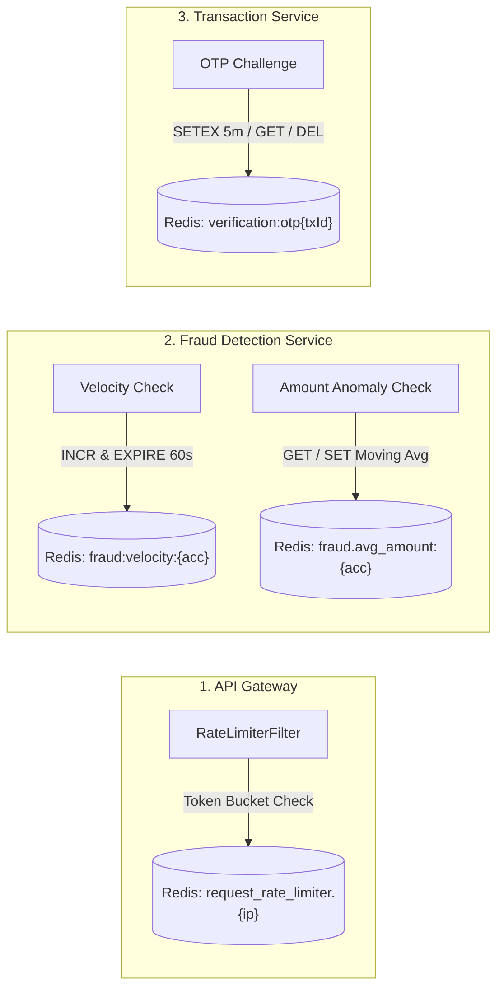
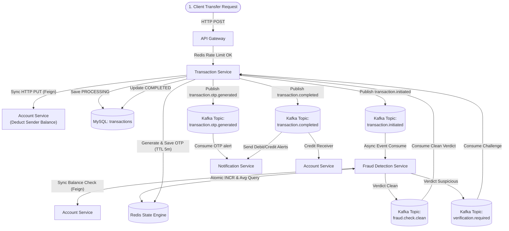

# 03. Kafka & Redis Deep Dive: End-to-End Event & State Flow

In this distributed banking system, **Apache Kafka** acts as the asynchronous, event-driven nervous system, while **Redis** serves as the ultra-fast, in-memory state engine for rate limiting, sliding window counters, and transient OTP challenges.

---

## 📨 1. Apache Kafka: Complete Event-Driven Architecture

### Master Kafka Topic Registry

| # | Topic Name | Producer Service | Consumer Service(s) | Consumer Group ID | Partition Key | Business Trigger & Meaning |
| :-: | :--- | :--- | :--- | :--- | :--- | :--- |
| **1** | `transaction.initiated` | `transaction-service` | `fraud-detection-service` | `fraud-detection-group` | `transactionId` | Transfer initiated; triggers 3-rule fraud analysis |
| **2** | `fraud.check.clean` | `fraud-detection-service` | `transaction-service` | `transaction-service-group` | `transactionId` | All fraud rules passed; authorizes transaction completion |
| **3** | `verification.required` | `fraud-detection-service` | `transaction-service` | `transaction-service-group` | `transactionId` | Anomaly detected; instructs Transaction service to challenge user with OTP |
| **4** | `transaction.otp.generated` | `transaction-service` | `notification-service` | `notification-service-group` | `transactionId` | OTP produced and cached; triggers dispatch of SMS/Email with OTP code |
| **5** | `transaction.completed` | `transaction-service` | `account-service`, `notification-service` | `account-service-group`, `notification-service-group` | `transactionId` | Transaction finalized; credits receiver account and dispatches debit/credit receipts |
| **6** | `fraud.detected` | `transaction-service` | `account-service`, `notification-service` | `account-service-group`, `notification-service-group` | `senderAccountNumber` | Failed authentication / security incident; freezes sender account and sends critical alert |
| **7** | `transaction.refunded` | `transaction-service` | `notification-service` | `notification-service-group` | `transactionId` | SAGA compensation executed; notifies sender of refunded balance |
| **8** | `payment.completed` | `payment-service` | `notification-service` | `notification-service-group` | `paymentId` | Razorpay webhook confirmed payment captured |
| **9** | `payment.failed` | `payment-service` | `notification-service` | `notification-service-group` | `paymentId` | Razorpay webhook confirmed payment failed |

---

### Detailed Topic Payloads & Data Contracts

#### Topic 1: `transaction.initiated`
```json
{
  "transactionId": "9b1deb4d-3b7d-4bad-9bdd-2b0d7b3dcb6d",
  "senderAccountNumber": "000184920491",
  "receiverAccountNumber": "000839201948",
  "amount": 15000.00,
  "description": "Monthly rent payment"
}
```

#### Topic 2: `fraud.check.clean`
```json
{
  "transactionId": "9b1deb4d-3b7d-4bad-9bdd-2b0d7b3dcb6d",
  "isFraud": false,
  "reason": null
}
```

#### Topic 3: `verification.required`
```json
{
  "transactionId": "9b1deb4d-3b7d-4bad-9bdd-2b0d7b3dcb6d",
  "senderAccountNumber": "000184920491",
  "amount": 15000.00,
  "reason": "Too many Transactions in 60 seconds - Velocity Limit exceeded"
}
```

#### Topic 4: `transaction.otp.generated`
```json
{
  "transactionId": "9b1deb4d-3b7d-4bad-9bdd-2b0d7b3dcb6d",
  "accountNumber": "000184920491",
  "amount": 15000.00,
  "otp": "481920",
  "reason": "Unusual Transaction Amount - Exceeds 3X your average"
}
```

#### Topic 5: `transaction.completed`
```json
{
  "transactionId": "9b1deb4d-3b7d-4bad-9bdd-2b0d7b3dcb6d",
  "senderAccountNumber": "000184920491",
  "receiverAccountNumber": "000839201948",
  "amount": 15000.00,
  "description": "Monthly rent payment"
}
```

#### Topic 6: `fraud.detected`
```json
{
  "transactionId": "9b1deb4d-3b7d-4bad-9bdd-2b0d7b3dcb6d",
  "senderAccountNumber": "000184920491",
  "reason": "Wrong OTP entered - transaction cancelled Account blocked for security"
}
```

#### Topic 7: `transaction.refunded`
```json
{
  "transactionId": "9b1deb4d-3b7d-4bad-9bdd-2b0d7b3dcb6d",
  "senderAccountNumber": "000184920491",
  "refundAmount": 15000.00,
  "reason": "OTP expired - Transaction cancelled and amount refunded"
}
```

---

### Kafka Configuration Best Practices Used

1. **Partition Key Usage:**
   - For `transaction.initiated` and `transaction.completed`, `transactionId` is used as the Kafka message key.
   - For `fraud.detected`, `senderAccountNumber` is used.
   - *Interview Talking Point:* Partitioning by account number or transaction ID ensures that all events regarding the same entity land on the **same Kafka partition**, guaranteeing **strict in-order message processing**.
2. **Consumer Group Separation:**
   - Both `account-service-group` and `notification-service-group` subscribe to `transaction.completed`.
   - Because they belong to different consumer groups, **both receive an independent copy of each event** (Pub/Sub pattern).
3. **Offset Strategy:**
   - `auto-offset-reset: earliest` ensures newly spun-up consumer instances process any unprocessed messages from the start of the partition log.

---

## ⚡ 2. Redis: In-Memory State & Caching Architecture

Redis is utilized in 4 distinct architectural scenarios across 3 microservices:



---

### Use Case 1: API Gateway Token-Bucket Rate Limiter
- **Service:** `api-gateway`
- **Mechanism:** Spring Cloud Gateway `RedisRateLimiter` using Lua scripts in Redis.
- **Key Pattern:** Internal Redis token bucket keys mapped per client IP (`userKeyResolver`).
- **Configuration:**
  - Account/Transaction endpoints: `replenishRate: 10`, `burstCapacity: 20` (allows 10 req/s with bursts up to 20).
  - Payment endpoints: `replenishRate: 5`, `burstCapacity: 10`.
- **Why Redis?** Distributed rate limiting requires atomic token deduction across multiple gateway instances. Redis Lua scripts execute atomically in $\mathcal{O}(1)$ time.

---

### Use Case 2: Fraud Velocity Tracking (Sliding Window Counter)
- **Service:** `fraud-detection-service`
- **Key Format:** `fraud:velocity:{accountNumber}`
- **Data Type:** Redis Integer String
- **TTL:** 60 seconds
- **Code Implementation:**
```java
String key = "fraud:velocity:" + accountNumber;
Long count = redisTemplate.opsForValue().increment(key);

if (count != null && count == 1) {
    redisTemplate.expire(key, 60, TimeUnit.SECONDS);
}

if (count != null && count > maxTransactionsPerMinute) {
    return true; // Velocity exceeded!
}
```
- **Why Redis?** Redis `INCR` is an atomic hardware-level operation. By setting the expiration on the first increment (`count == 1`), the key automatically resets every 60 seconds without manual scheduled cron jobs or database cleanup scripts.

---

### Use Case 3: Historical Spending Baseline (Moving Average)
- **Service:** `fraud-detection-service`
- **Key Format:** `fraud.avg_amount:{accountNumber}`
- **Data Type:** String representation of `BigDecimal`
- **TTL:** Persistent (no automatic expiration)
- **Code Implementation:**
```java
String avgKey = "fraud.avg_amount:" + accountNumber;
String avgStr = redisTemplate.opsForValue().get(avgKey);

if (avgStr == null) {
    redisTemplate.opsForValue().set(avgKey, amount.toString());
    return false;
}

BigDecimal avgAmount = new BigDecimal(avgStr);
BigDecimal threshold = avgAmount.multiply(BigDecimal.valueOf(suspiciousAmountMultiplier));

// Calculate updated moving average: (avg + current) / 2
BigDecimal newAvg = avgAmount.add(amount).divide(BigDecimal.valueOf(2), 2, RoundingMode.HALF_UP);
redisTemplate.opsForValue().set(avgKey, newAvg.toString());

return amount.compareTo(threshold) > 0;
```
- **Why Redis?** Comparing against an account's historical spending requires sub-millisecond retrieval. Doing this via SQL `SELECT AVG(amount) FROM transactions WHERE ...` would require full table scans, causing database lock contention during high transaction volume.

---

### Use Case 4: Temporary OTP Lifecycle Management
- **Service:** `transaction-service`
- **Key Format:** `verification:otp{transactionId}`
- **Data Type:** String (6-digit numeric OTP)
- **TTL:** 5 Minutes (`TimeUnit.MINUTES`)
- **Code Implementation:**
```java
// Storing OTP upon generation:
String otp = String.format("%06d", (int) (Math.random() * 900000 + 100000));
String otpKey = "verification:otp" + transactionId;
redisTemplate.opsForValue().set(otpKey, otp, 5, TimeUnit.MINUTES);

// Verification and automatic invalidation:
String storedOtp = redisTemplate.opsForValue().get(otpKey);
if (storedOtp == null) {
    // Expired! Trigger SAGA compensating refund
} else if (!storedOtp.equals(otp)) {
    // Wrong OTP! Delete key and trigger SAGA account freeze + refund
    redisTemplate.delete(otpKey);
} else {
    // Success! Delete OTP to prevent replay attacks
    redisTemplate.delete(otpKey);
}
```
- **Why Redis?**
  1. **Automatic Garbage Collection:** Keys with TTLs are automatically evicted by Redis without background cleanup daemons.
  2. **Security:** Immediate deletion upon read (`redisTemplate.delete`) prevents OTP replay attacks.
  3. **Performance:** Does not pollute transactional relational database tables with short-lived OTP tokens.

---

## 🔄 Summary of Flow Interconnection: From Request to Settlement



