# 04. SAGA Pattern, Distributed Consistency & Resiliency

In a distributed microservice architecture with independent databases per service (**Database-per-Service** pattern), maintaining traditional ACID transactions across network boundaries is impossible without distributed locks.

This document explains how this project achieves **Eventual Consistency** using the **SAGA Pattern**, compensates on failures, and guarantees idempotency.

---

## ⚖️ Why Not 2-Phase Commit (2PC)?

| Feature | 2-Phase Commit (2PC) / XA Transactions | SAGA Pattern (Used in this Project) |
| :--- | :--- | :--- |
| **Consistency Model** | Immediate / Strong Consistency | Eventual Consistency |
| **Locking Mechanism** | Distributed locks across all databases | Local database transactions only; no cross-service locks |
| **Throughput & Latency** | Low throughput; high latency due to blocking locks | High throughput; asynchronous, non-blocking |
| **Availability (CAP Theorem)** | Sacrifices Availability for Consistency ($CP$) | Prioritizes Availability and Partition Tolerance ($AP$) |
| **Failure Handling** | Complex rollback; can stall entire cluster if coordinator dies | Explicit **Compensating Transactions** undo previous steps |

---

## 🧩 SAGA Implementation in This Project

This project uses a **Hybrid SAGA** approach combining **Orchestration** (led by `transaction-service`) and **Choreography** (using Kafka topics):

```mermaid
flowchart TD
    subgraph ForwardFlow ["▶️ SAGA Forward Steps (Happy Path)"]
        F1["Step 1: Deduct from Sender<br/>(Sync Feign to Account Service)"] --> F2["Step 2: Save Transaction<br/>(Status: PROCESSING in DB)"]
        F2 --> F3["Step 3: Publish transaction.initiated<br/>(Async Kafka Event to Fraud Service)"]
        F3 --> F4["Step 4: Consume fraud.check.clean<br/>(Transaction Service marks COMPLETED)"]
        F4 --> F5["Step 5: Publish transaction.completed<br/>(Account Service credits receiver)"]
    end

    subgraph CompensatingFlow ["⏪ SAGA Compensating Steps (Failure / Fraud)"]
        C1["Trigger: Wrong OTP, Expired OTP, or Fraud"] --> C2["Compensating Action 1:<br/>Credit Sender via Feign (Refund)"]
        C2 --> C3["Compensating Action 2:<br/>Mark Status FLAGGED in DB"]
        C3 --> C4["Compensating Action 3:<br/>Publish fraud.detected (Account blocked)"]
        C4 --> C5["Compensating Action 4:<br/>Publish transaction.refunded (User alerted)"]
    end
```



---

## 🔍 Code Inspection: SAGA Steps in Detail

### Step 1: Forward Step (Deduct Sender Balance)
Located in [`TransactionService.java`](file:///d:/Java%20Projects/Banking-system/transaction-service/transaction-service/src/main/java/com/banking/transactionservice/service/TransactionService.java#L60-L75):
```java
// SAGA Step 1: Deduct from Sender immediately to lock/reserve liquidity
accountServiceClient.deductBalance(transferRequest.getAmount(), transferRequest.getSenderAccountNumber());

// Save transaction record in PROCESSING state
Transaction transaction = new Transaction();
transaction.setSenderAccountNumber(transferRequest.getSenderAccountNumber());
transaction.setReceiverAccountNumber(transferRequest.getReceiverAccountNumber());
transaction.setAmount(transferRequest.getAmount());
transaction.setStatus(TransactionStatus.PROCESSING);
transaction.setReferenceNumber(UUID.randomUUID().toString());
Transaction savedTransaction = transactionRepository.save(transaction);
```

### Step 2: Asynchronous Event Dispatch (Fraud Verification)
```java
// SAGA Step 2: Publish event for asynchronous fraud inspection
TransactionInitiatedEvent initiatedEvent = new TransactionInitiatedEvent(...);
kafkaTemplate.send("transaction.initiated", savedTransaction.getId(), initiatedEvent);
```

### Step 3: Happy Path Completion (Credit Receiver)
Located in [`TransactionService.java`](file:///d:/Java%20Projects/Banking-system/transaction-service/transaction-service/src/main/java/com/banking/transactionservice/service/TransactionService.java#L157-L175):
```java
private void completeTransaction(Transaction transaction) {
    transaction.setStatus(TransactionStatus.COMPLETED);
    transaction.setCompletedAt(LocalDateTime.now());
    transactionRepository.save(transaction);

    // Publishes event to Kafka so Account Service can credit receiver
    TransactionCompletedEvent completedEvent = new TransactionCompletedEvent(...);
    kafkaTemplate.send(TRANSACTION_COMPLETED_TOPIC, transaction.getId(), completedEvent);
}
```

### Step 4: SAGA Compensating Transaction (Refund Sender)
Located in [`TransactionService.java`](file:///d:/Java%20Projects/Banking-system/transaction-service/transaction-service/src/main/java/com/banking/transactionservice/service/TransactionService.java#L198-L224):
```java
private void compensateTransaction(Transaction transaction, String reason) {
    log.warn("SAGA COMPENSATE. Refunding: {} and amount {}",
            transaction.getSenderAccountNumber(), transaction.getAmount());

    // 1. COMPENSATING REST CALL: Call Account Service to refund deducted money
    accountServiceClient.creditBalance(transaction.getSenderAccountNumber(), transaction.getAmount());

    // 2. STATE PERSISTENCE: Mark transaction FLAGGED with audit trail
    transaction.setStatus(TransactionStatus.FLAGGED);
    transaction.setFailureReason(reason + " - SAGA Compensation executed, amount refunded at " + LocalDateTime.now());
    transactionRepository.save(transaction);

    // 3. ASYNC NOTIFICATION: Alert user of the refund
    Map<String, Object> refundEvent = new HashMap<>();
    refundEvent.put("transactionId", transaction.getId());
    refundEvent.put("senderAccountNumber", transaction.getSenderAccountNumber());
    refundEvent.put("refundAmount", transaction.getAmount());
    refundEvent.put("reason", reason);
    kafkaTemplate.send(TRANSACTION_REFUNDED_TOPIC, transaction.getId(), refundEvent);
}
```

---

## 🛡️ Idempotency: Handling At-Least-Once Delivery

Because Kafka guarantees **at-least-once delivery**, network hiccups or consumer rebalancing can cause duplicate event deliveries. Without idempotency guards, duplicate messages could credit an account twice or trigger redundant refunds.

### Idempotency Guard in `TransactionService`:
Located in [`TransactionService.java`](file:///d:/Java%20Projects/Banking-system/transaction-service/transaction-service/src/main/java/com/banking/transactionservice/service/TransactionService.java#L226-L235):
```java
public void processCleanResult(String transactionId) {
    Transaction transaction = transactionRepository.findById(transactionId)
        .orElseThrow(() -> new RuntimeException("No transaction found"));

    // IDEMPOTENCY CHECK: Ensure transaction is still in PROCESSING state
    // If a duplicate Kafka message arrives, status is already COMPLETED -> Skipped!
    if (transaction.getStatus() != TransactionStatus.PROCESSING) {
        log.warn("Transaction {} not in PROCESSING state (current: {}). Skipping.",
                transactionId, transaction.getStatus());
        return;
    }

    completeTransaction(transaction);
}
```

### Idempotency Guard in `TransactionEventConsumer`:
Located in [`TransactionEventConsumer.java`](file:///d:/Java%20Projects/Banking-system/transaction-service/transaction-service/src/main/java/com/banking/transactionservice/service/TransactionEventConsumer.java#L58-L62):
```java
// Prevents generating duplicate OTPs if verification.required is re-delivered
if (transaction.getStatus() != TransactionStatus.PROCESSING) {
    log.warn("Transaction {} not processing. Skipping OTP generation.", transactionId);
    return;
}
```

---

## ⚠️ Failure Scenarios & Edge Cases

### Scenario A: Network failure when Transaction Service calls Account Service
- **What happens:** The Feign client throws a `FeignException` or timeout exception before any database write occurs in `transaction-service`.
- **Handling:** The request immediately fails with an HTTP 500 error back to the caller. No funds are lost because the sender deduction call either failed or rolled back.

### Scenario B: Attacker tries brute-forcing OTP
- **What happens:** The first wrong OTP attempt deletes the OTP key from Redis immediately (`redisTemplate.delete(otpKey)`).
- **Handling:** The account is instantly blocked via `fraud.detected`, and compensating refund is issued. Re-attempting will encounter an expired/absent OTP key.

### Scenario C: Kafka Broker becomes temporarily unreachable
- **What happens:** `kafkaTemplate.send()` can be buffered or throw an error depending on producer acks configuration.
- **Production Improvement:** Implement the **Transactional Outbox Pattern** (saving events to an `outbox` table in MySQL in the same local ACID transaction as the entity, then using Debezium CDC or a poller to publish to Kafka).

